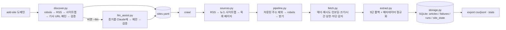

# news-crawler

코드 수정 없이 설정만으로 새 뉴스 사이트를 추가할 수 있는 범용 뉴스 크롤러. (SeSAC 과제, 2026-10)

새 사이트를 넣을 때 고치는 코드는 없다. `add-site` 가 사이트를 자동으로 조사해 `sites.yaml` 에 블록을 쓰고, `crawl` 은 그 블록만 읽는다.

## 한 줄 사용법
```bash
pip install -r requirements.txt
python main.py add-site hani.co.kr        # 도메인 하나로 사이트 등록 (RSS·사이트맵·기사 URL 규칙 자동 탐지)
python main.py list-sites                 # 등록된 사이트 표
python main.py crawl                      # 등록된 모든 사이트에서 새 기사를 받아 data/news.db 에 저장 (재실행하면 새 기사만)
python main.py crawl --only hani.co.kr --limit-per-site 20 --report docs/crawl_report.md
python main.py crawl --every 30           # 30분마다 반복
python main.py export --format csv        # data/export/articles_날짜.csv  (--site, --since, --until, --limit, --format jsonl)
python main.py stats                      # DB 현황, 사이트별 건수, 마지막 실행, 실패 이유, 차단 쿨다운
python main.py discover tbs.seoul.kr --llm --dry-run   # 자동 탐지가 비면 Claude 에 물을 내용 미리보기
python main.py extract https://www.hani.co.kr/arti/economy/it/1281224.html   # 기사 1건 추출 확인(디버그)
python -m pytest                          # 오프라인 테스트 (네트워크 없이 39개)
```

## 구조



| 파일 | 역할 | 단계 |
|---|---|---|
| `crawler/fetch.py` | HTTP 수집 계층. 브라우저형 헤더, 재시도(5xx·네트워크 오류), EUC-KR/CP949 안전 디코딩, 응답 5MB·45초 상한, 봇 차단·429 감지 | 1 |
| `crawler/extract.py` | 기사 추출. 추출기 5단 폴백 + 메타데이터 보완 + 날짜·기자 정규화, 제목 목록 오인 거부 | 1 |
| `crawler/discover.py` | 사이트 자동 탐지. robots.txt → RSS → 사이트맵 → 기사 URL 패턴(템플릿 병합 + 샘플 검증) → 목록 페이지 후보 | 2 |
| `crawler/config.py` | `sites.yaml` 읽기/쓰기. 키는 홈 호스트(`hani.co.kr`, `h21.hani.co.kr`) | 3 |
| `crawler/sources.py` | 설정 블록에서 기사 주소 수집: RSS → 뉴스 사이트맵 → 목록 페이지. 네트워크 오류·차단 차단기 | 4 |
| `crawler/pipeline.py` | 수집 → 추출 → 저장. 저장된 주소 제외, robots.txt·Crawl-delay, 차단 쿨다운 | 4 |
| `crawler/storage.py` | SQLite 저장소. 본문 해시 중복 제거, 실패·실행 기록, 차단 상태, CSV/JSONL 내보내기 | 4 |
| `crawler/llm_assist.py` | 자동 탐지가 빈 사이트에 Claude 제안(기사 URL 규칙·목록 페이지·RSS)을 받아 검증 후 반영 | 7 |
| `main.py` | CLI: `add-site`, `discover`, `list-sites`, `crawl`, `export`, `stats`, `unblock`, `extract` | 5 |
| `tests/` | 네트워크 없이 도는 pytest 39개 (가짜 응답으로 파이프라인·차단·중복까지) | - |
| `scripts/` | 246개 언론사 1차 조사, 추출 품질 평가, 탐지 일괄 평가, 유료벽 점검 | - |

## 1단계: 기사 1건 추출 (`extract`)
앞 단계 본문이 200자 미만이면 다음 단계도 시도하고, 모두 짧으면 가장 긴 결과를 쓴다(80자 이상이면 성공).

1. trafilatura (정밀도 우선)
2. JSON-LD `NewsArticle.articleBody`
3. trafilatura (재현율 우선)
4. readability-lxml
5. newspaper4k

메타데이터는 추출기 결과 → `<meta>` 태그 → JSON-LD → `<title>` → 본문 바이라인(`홍길동 기자`) 순으로 채운다.
날짜는 `YYYY-MM-DD HH:MM`(KST)로 통일한다. CSS·이미지 같은 비HTML 응답은 추출을 거부하고,
"많이 본 기사" 같은 제목 목록을 본문으로 집은 결과는 버린다.

**품질** (2026-10-07, `docs/extract_quality.md`): 기사 URL을 확보한 196곳에서 사이트당 1건 →
본문 성공 193/196 (98%), 제목·날짜 100%, 기자 96%, 언론사명 90%.
실패 3곳은 403(한국경제 프리미엄)·404(죽은 링크)·기사 아닌 페이지로의 리다이렉트.

## 2단계: 사이트 자동 탐지 (`discover` / `add-site`)
입력은 도메인 하나. 나머지는 전부 자동이고, 찾은 것은 전부 실제 요청으로 검증한다.

1. **robots.txt**: `Sitemap:` 선언과 `Crawl-delay`
2. **RSS**: `<link rel=alternate>` → 페이지 안의 rss/feed 링크 → 한국 CMS에 흔한 경로 추측(`/rss/allArticle.xml` 등 14종)
   → RSS 안내 페이지(HTML)에 나열된 피드 재수집. 받아서 항목이 있는 것만 채택
3. **사이트맵**: robots 선언 + 경로 추측 8종. 뉴스 사이트맵(`news:` 네임스페이스)은 따로 표시
4. **기사 URL 패턴**: RSS 항목 → 뉴스 사이트맵 항목 → 홈페이지 링크 순으로 기사 주소를 모아
   숫자 ID는 `\d+`, 카테고리 자리는 `[^/]+`로 일반화한 정규식을 만든다. 샘플 1건을 실제로 추출해
   긴 문단과 기사 메타 신호(og:type, JSON-LD, 발행시각)가 있을 때만 채택
5. **목록 페이지 후보**: 홈페이지의 섹션 링크(기사가 아닌 얕은 경로). RSS·사이트맵이 없는 사이트의 3순위 수집 경로

```yaml
# sites.yaml 블록 예 (add-site 가 자동 작성)
- name: 한겨레
  domain: hani.co.kr
  home: https://www.hani.co.kr/
  rss: [https://www.hani.co.kr/rss]
  sitemaps: [https://www.hani.co.kr/sitemap/sections, https://www.hani.co.kr/sitemap/latest-articles]
  news_sitemaps: [https://www.hani.co.kr/sitemap/latest-articles]
  article_patterns: ['^https?://(?:www\.)?hani\.co\.kr/arti/[^/]+/[^/]+/\d+\.html(?:[?#&].*)?$']
  list_pages: [https://www.hani.co.kr/arti/opinion, ...]
```

**품질** (2026-10-08, `docs/discovery_results.md`): 네이버 뉴스스탠드 246곳에 홈페이지 주소만 주고 실행 →
첫 전체 실행에서 234곳(95%)이 RSS·뉴스 사이트맵·검증된 기사 패턴 중 하나 이상을 얻었다(RSS 166, 뉴스 사이트맵 178, 기사 패턴 232).
같은 날 전체 실행을 세 번 반복하자 같은 호스팅을 쓰는 20곳이 일시적으로 403을 돌려줘 마지막 기록은 222곳이다.
이 20곳은 일부러 설정에 넣지 않고 보류 집합으로 두었다가, 차단이 풀린 2026-10-09 에 **코드를 한 줄도 고치지 않고 `add-site` 한 줄씩으로 20/20 전부 추가하고
각 사이트에서 기사 3건씩 수집까지 성공**했다 ([`docs/holdout_test.md`](docs/holdout_test.md), 목록은 [`docs/holdout_sites.md`](docs/holdout_sites.md)).
현재 등록 사이트는 244곳이다.
탐지는 사이트당 평균 5초, 요청 20~30회(간격 0.4초, 사이트당 90초 예산).

## 3·4·5단계: 설정 파일, 파이프라인, CLI
`sites.yaml` 의 블록 하나가 사이트 하나다. `crawl` 은 사이트마다 다음을 한다.

1. 기사 주소 수집: RSS → 뉴스 사이트맵 → 목록 페이지 순서 (`crawler/sources.py`)
2. 이미 저장했거나 처리한 주소 제외 → 재실행하면 새 기사만 받는다 (본문 중복은 영구, 추출 실패는 3일 뒤 재시도)
3. robots.txt 확인: 금지된 주소는 건너뛰고 세며, `Crawl-delay` 와 설정의 `crawl_delay` 중 큰 값을 요청 간격으로 쓴다 (기본 1초)
4. 받기 → 1단계 추출기 → SQLite 저장 (`data/news.db`). 같은 사이트 안에서 본문이 같은 기사는 중복으로 세고 저장하지 않는다

사이트끼리는 동시에(기본 6개), 한 사이트 안에서는 순서대로 간격을 두고 요청한다. 한 사이트의 사고는 그 사이트에서 끝난다.

**시연 수집** (2026-10-09, `docs/crawl_report.md`): 등록된 223곳에서 사이트당 새 기사 최대 10건.

| 항목 | 값 |
|---|---|
| 소요 | 9분 (작업자 10, 요청 간격 1초) |
| 수집한 기사 주소 | 5,220 |
| 저장 | 2,027건 (211곳) |
| 본문 중복 | 28 |
| 받기·추출 실패 | 32 (대부분 본문이 JS로 그려지는 페이지) |
| robots.txt 로 건너뜀 | 90 (EBS, KBS World, MBC, TJB, 동아사이언스, 아시아경제, 톱데일리 등 7곳은 `Disallow: /`. 규칙대로 수집하지 않는다) |

내보내기 예: [`docs/sample_articles_200.csv`](docs/sample_articles_200.csv) (최신 200건). DB와 전체 내보내기 파일은 `data/` 에 있고 git 에는 넣지 않는다.

## 7단계: 자동 탐지가 빈 사이트에 LLM 보조 (`--llm`)
`add-site 도메인 --llm` 은 자동 탐지가 수집 경로를 하나도 못 찾았을 때만 Claude(`claude-opus-5-5`)를 부른다.
홈페이지 HTML 전체가 아니라 **증거만** 보낸다: 제목, 메타, 내부 링크를 URL 꼴별로 묶어 대표 몇 개씩(최대 300개), 피드 태그, robots 사이트맵 선언.
Claude 는 기사 URL 정규식·기사 예시·목록 페이지·RSS 후보를 구조화된 JSON 으로 돌려주고, 코드가 검증한다.
정규식은 실제 링크에 3개 이상 맞고 샘플 1건이 기사로 추출돼야 채택, RSS 는 받아서 항목이 있어야 채택, 목록 페이지는 같은 도메인만.
자격 증명은 `ANTHROPIC_API_KEY` 또는 `ant auth login`. 없으면 `--dry-run` 으로 보낼 내용만 볼 수 있다.
한계: Arirang TV 처럼 홈페이지가 자바스크립트로만 그려져 HTML 에 링크가 없는 사이트는 증거 자체가 비어 LLM 도 도울 수 없다(6단계 Playwright 영역).

## 6단계(가벼운 길): HTML 안 JSON 에서 본문 꺼내기 (`crawler/embedded.py`)
자바스크립트로 화면을 그리는 사이트 중 상당수는 본문을 HTML 안의 JSON 덩어리에 실어 보낸다. 브라우저를 띄우지 않고 그 JSON 만 읽는다.
지원: Arc XP(`Fusion.globalContent`, 조선일보 계열), Next.js(`__NEXT_DATA__`), `__INITIAL_STATE__`·`__PRELOADED_STATE__` 류, `<script type="application/json">`.
구조를 모르면 "문장처럼 보이는 긴 문자열"을 같은 자리끼리 묶어 가장 큰 묶음을 본문으로 본다. 추출 순서에서 JSON-LD 다음, trafilatura 재현율 모드 앞에 들어간다.
홈페이지에 `<a>` 가 거의 없는 자바스크립트 앱은 스크립트 속 JSON 의 주소라도 모아 탐지에 쓴다.

**결과** (2026-10-10): 조선일보가 살아났다. 정적 요청으로 본문 0자였던 기사가 1,000~7,000자로 추출되고(추출기 `embedded`), 조선일보·조선비즈·IT조선·헬스조선·월간 산·주간조선에서 각 5건씩 저장했다.
**안 되는 것**: SBS Biz, SBS연예뉴스, 스타뉴스, Arirang TV 는 본문·링크를 HTML 이 아니라 별도 요청(XHR)으로 받아 오므로 JSON 이 HTML 에 없다. 이 넷은 Playwright 가 필요하다.

## 유료·로그인 벽 점검 (`docs/paywall_check.md`)
`scripts/check_paywall.py` 가 사이트마다 기사 8건을 같은 세션으로 순서대로 읽고 마지막에 첫 기사를 다시 읽어,
계량 페이월(뉴욕타임스식)과 부분 잠금을 찾는다. 결과: 222곳 중 계량 페이월 0곳, 부분 잠금 2곳(식품저널 `[동향]` 시리즈는 유료회원 전용,
시사IN 일부 기사는 후원자 로그인 후 전문), 페이월 장치만 있고 기사는 열린 곳 5곳, 판정 불가 5곳(JS 렌더링 또는 포토 기사).
한계: 자바스크립트로만 동작하는 클라이언트 측 계량은 정적 요청으로는 보이지 않는다.

**뉴욕타임스 점검** (`docs/nyt_check.md`): 요청 3회(robots, 공식 RSS, 기사 1건)만 보냈다. robots 와 RSS 는 열리지만
기사 1건부터 403 + Datadome 봇 검사 페이지. 본문은 정적 요청으로 수집할 수 없고 이용약관도 자동 수집을 금지하므로 대상에 넣지 않았다.

## 안 막히기 위한 장치
- 같은 사이트 안 요청 간격 기본 1초, robots.txt 의 `Crawl-delay` 와 금지 경로 준수, 429 는 재시도하지 않음
- 응답에서 봇 검사 페이지(Datadome, Cloudflare, PerimeterX, Incapsula, Akamai)·429 를 알아보면 그 사이트에 **즉시** 요청을 끊음.
  단순 403 은 특정 주소만 막힌 것일 수 있어 연속 2회(자동 탐지는 3회)일 때 차단으로 봄
- 차단이 감지된 사이트는 DB `site_state` 에 쿨다운(기본 24시간, `Retry-After` 가 더 길면 그 값)을 적어 다음 실행에서도 건너뜀.
  `python main.py stats` 로 확인, 풀렸다고 확인한 뒤에만 `python main.py unblock 사이트키`
- 네트워크 오류 2회 연속이면 그 사이트 포기, 요청 하나는 45초·5MB 상한, 사이트 하나는 시간 예산(기본 240초)
- 246곳 전체 자동 탐지를 같은 날 반복해 20곳이 일시 차단된 경험이 있다. 전체 스윕은 하루 한 번으로 제한한다

## 한계와 실패 사례 (정직하게)
- **JS 렌더링 사이트**: SBS Biz, SBS연예, 스타뉴스, Arirang TV 는 본문·링크를 별도 요청(XHR)으로 받아 와 HTML 에 없다. Playwright 가 필요하다(6단계 무거운 길, 미구현). 조선일보는 HTML 속 JSON 에서 꺼내는 가벼운 길로 해결했다.
- **봇 차단 사이트**: 매일경제(Cloudflare), 뉴욕타임스(Datadome). 헤더만으로는 안 열리고, 뚫으려 하면 IP 차단으로 번진다. 수집 대상에서 뺐다.
- **robots.txt 로 전부 금지한 7곳**: 기술적으로는 받을 수 있지만 받지 않는다.
- **포토 기사**: 본문이 100자 안팎이라 80자 기준은 넘지만 내용은 사진 설명뿐이다.
- **부분 유료 기사**: 식품저널 `[동향]`, 시사IN 일부는 앞부분만 저장된다(잠금 신호는 `docs/paywall_check.csv` 에 기록).
- **자동 탐지의 한계**: 처음 실행 때 CSS·이미지·목록 페이지를 기사로 고른 사례가 18곳 있었고, 이를 계기로 비HTML 거부와 기사 검증(긴 문단 + 메타 신호)을 넣었다.
- **반복 실행의 부작용**: 같은 호스팅의 작은 신문사 20곳이 하루 세 번 전체 탐지 뒤 403 을 돌려줬다. 보류 집합으로 남겨 두었다.

## 관련 오픈소스
비슷한 목표의 프로젝트(news-please, fundus, KoreaNewsCrawler 등)와 우리가 쓴 라이브러리의 별·다운로드 수, 차이점은 [`docs/related_opensource.md`](docs/related_opensource.md).

## 남은 단계
6. Playwright 폴백 — JS 렌더링·봇 차단 사이트
- `ANTHROPIC_API_KEY` 가 있는 환경에서 `--llm` 실제 호출 시험
